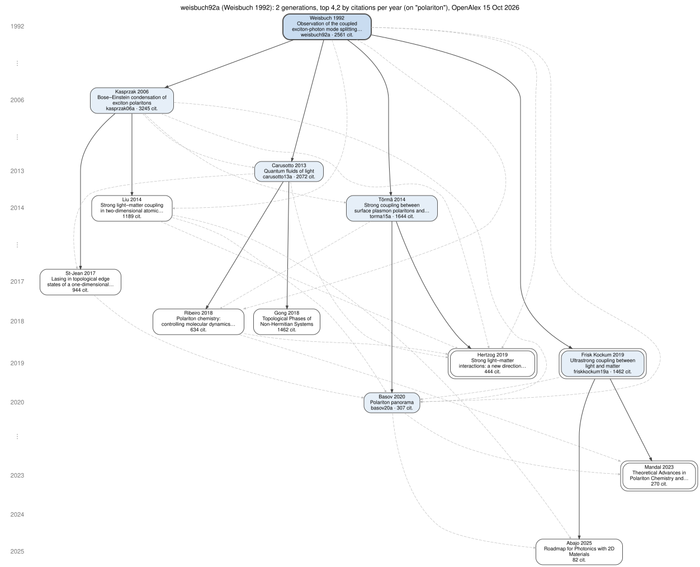

# vip

*Very important papers*: from one paper, the tree of the most important works that cite it, then of the most important works that cite those, and so on.

```
vip weisbuch92a -n 4,2 --topic polariton
```

grows the descendants of Weisbuch *et al.*, *Observation of the coupled exciton-photon mode splitting in a semiconductor quantum microcavity* (1992), keeping its four works on polaritons with the most citations per year, and two for each of those:

```
  [n] year  cites   /yr
  [0] 1992   2561  75.6    weisbuch92a  Weisbuch  Observation of the coupled exciton-photon mode splitting in a semiconductor quantum microcavity
  [1] 2019   1462 187.9 R  ├─ friskkockum19a  Frisk Kockum  Ultrastrong coupling between light and matter
  [2] 2023    270  84.7 R  │  ├─ 10.1021/acs.chemrev.2c00855  Mandal  Theoretical Advances in Polariton Chemistry and Molecular Cavity Quantum Electr…
  [3] 2025     82  66.9    │  └─ 10.1021/acsphotonics.5c00353  Abajo  Roadmap for Photonics with 2D Materials
  [4] 2006   3245 161.3    ├─ kasprzak06a  Kasprzak  Bose–Einstein condensation of exciton polaritons
  [5] 2017    944 104.0    │  ├─ 10.1038/s41566-017-0006-2  St-Jean  Lasing in topological edge states of a one-dimensional lattice
  [6] 2014   1189 100.7    │  ├─ 10.1038/nphoton.2014.304  Liu  Strong light–matter coupling in two-dimensional atomic crystals
                           │  ├─ see [7] carusotto13a
                           │  └─ see [10] torma15a
  [7] 2013   2072 151.8    ├─ carusotto13a  Carusotto  Quantum fluids of light
  [8] 2018   1462 181.4    │  ├─ 10.1103/physrevx.8.031079  Gong  Topological Phases of Non-Hermitian Systems
  [9] 2018    634  72.2    │  ├─ 10.1039/c8sc01043a  Ribeiro  Polariton chemistry: controlling molecular dynamics with optical cavities
                           │  └─ see [5] 10.1038/s41566-017-0006-2
 [10] 2014   1644 139.2    └─ torma15a  Törmä  Strong coupling between surface plasmon polaritons and emitters: a review
 [11] 2019    444  57.0 R     ├─ 10.1039/c8cs00193f  Hertzog  Strong light–matter interactions: a new direction within chemistry
 [12] 2020    307  51.8       ├─ basov20a  Basov  Polariton panorama
                              └─ see [9] 10.1039/c8sc01043a
```

Works in the BibTeX files are named by their key, the others by their DOI. **R** marks a review, **P** a preprint, **\*** a work sharing an author with the one above it. A work is shown once; when it is again among the best citers of another work, a `see [n]` line points to it. Here Carusotto and Ciuti's *Quantum fluids of light* [7] descends from Weisbuch directly, and is also among the most read works citing Kasprzak *et al.* [4].

The same tree drawn by Graphviz (`-o tree.svg`), one row per year, the tree's own links solid, the other citations between its works dashed; double frames are reviews, shaded boxes are in the bib files:



## Why

A paper's citing works number in the hundreds or thousands, and most of them cite it in passing. What one wants to know is where it led: which important works came out of it, and which out of those. `vip` follows the citations forward and keeps, at each step, only the few works that matter most, so that the result fits on a page: a family tree of a result, a reading list for a field grown from its founding paper, or the material for a review's historical introduction.

All counts come from [OpenAlex](https://openalex.org), so that they compare with one another. For the complete list of works citing one paper, from three indexes, see [citing](https://github.com/laussy/citing).

## Install

`vip` is a single Python 3 file, standard library only, that uses the functions of [citing](https://github.com/laussy/citing) (2.0.0 or later). Put both in the same directory, or `citing` anywhere on the `PATH`:

```
curl -O https://raw.githubusercontent.com/laussy/citing/main/citing
curl -O https://raw.githubusercontent.com/laussy/vip/main/vip
chmod +x citing vip
```

Drawings (`.svg`, `.pdf`, `.png`) need [Graphviz](https://graphviz.org)'s `dot`.

## Usage

```
vip PAPER [options]

  PAPER                 a DOI, an arXiv id, an OpenAlex id (W...), or a key of the --bib files

Truncation:
  -d, --depth D         generations below the paper (default 2)
  -n, --top N[,N2,...]  works kept under each work; a list gives one number per
                        generation, and the depth is then its length (default 5)
  -r, --rank BY         rate: citations per year since publication (default)
                        recent: citations in this year and the two before
                        cites: all citations
      --min-cites N     leave out works cited fewer than N times
      --since YEAR      leave out works published before YEAR
      --until YEAR      leave out works published after YEAR
      --type TYPES      only these OpenAlex types (review, article, preprint, ...)
      --topic WORDS     only works with WORDS in their title or abstract
      --no-self         leave out works sharing an author with the work they are placed under
      --max N           stop when the tree holds N works (default 300)
      --pool N          citing works read per work before ranking (default 200)

Output:
  -b, --bib FILES       BibTeX file(s), comma-separated: works get their key
  -f, --format FMT      text (default), json, dot, wiki, keys, ids
  -o, --output FILE     write there; a .svg, .pdf or .png is drawn by dot
      --no-links        no "see [n]" lines, and in the drawing only the tree's own links
  -W, --width N         cut text lines at N characters (default: the terminal's width)
      --fresh           do not use the cache
      --mailto EMAIL    contact for the OpenAlex polite pool (or env VIP_MAILTO)
      --openalex-key K  OpenAlex API key (or env OPENALEX_API_KEY)
  -q, --quiet           no progress or summary on stderr
```

### How the tree is grown

For each work, `vip` asks OpenAlex for the works citing it: the 200 most cited, and, unless ranking by all citations, the 200 most cited of the last five years, so that a recent work read widely is not lost behind older ones with more citations. A preprint and its published version are counted once. The candidates are ranked and the best N kept; then each of them is treated in the same way, generation after generation, breadth first, until the depth or `--max` is reached.

Ranking by citations per year (the default) puts a work of 2020 cited 300 times next to one of 2005 cited 1,000 times; the age is counted from the publication date, with a floor of one year so that a paper of last month does not top the list on two citations. `--rank recent` asks which works are read now, `--rank cites` which have been read most.

The filters (`--topic`, `--type`, `--since`, `--until`, `--min-cites`) apply at every generation and are sent to OpenAlex, so the ranking is done among the works that pass them. Without `--topic`, a tree soon leaves the paper's field through its most cited descendants: from Weisbuch 1992, by way of Mak and Shan's review of 2D semiconductor photonics, it reaches surveys of transition-metal dichalcogenides within two generations.

### Recipes

A reading list of a field, three generations, ten works then five then three:

```
vip weisbuch92a -n 10,5,3 --topic "polariton condensate" -f wiki > tree.wiki
```

The reviews descended from a paper, read now:

```
vip 10.1103/PhysRevLett.69.3314 -d 1 -n 20 --type review --rank recent
```

The descendants not yet in your bibliography, as DOIs for a DOI-to-BibTeX tool:

```
vip somekey14a -b refs.bib -n 8,4 -f ids
```

The drawing, without the cross-links:

```
vip somekey14a -b refs.bib -n 6,3 --no-links -o tree.pdf
```

### Formats

- **text**: the tree above. Columns: number in the tree, year, citations, the ranking figure, marks, then key or DOI, first author and title.
- **json**: every work with its place in the tree (`parent`, `depth`, `see`), identifiers, authors, counts, and every citation between works of the tree (`citations`, with `tree: true` for the links of the tree itself).
- **dot**: the drawing's Graphviz source; each box links to the DOI (in an SVG).
- **wiki**: a nested MediaWiki list, `{{key}}` for works with a key, a DOI link otherwise.
- **keys**: the bib keys in the tree, one per line; **ids**: the DOIs or arXiv ids of the works with no key.

### Defaults and cache

`~/.viprc` (or the file named by the environment variable `VIP_RC`) holds options as on the command line; `--bib`, `--mailto` and `--openalex-key` are also taken from `~/.citingrc` when `~/.viprc` does not give them. A paper can then be named by its key with no `-b`.

OpenAlex's answers are kept for seven days in `~/.cache/vip`, so trying other truncations of the same tree costs little; `--fresh` asks again.

## Limitations

- **One index.** OpenAlex misses some citations that OpenCitations or Semantic Scholar have (see `citing`), and its counts are lower than Google Scholar's. The tree is a ranking among what OpenAlex links.
- **Budget.** Without an API key OpenAlex gives each address a daily budget (1,000 credits in 2026). A citation query costs one credit, and a tree of 30 works takes 10 to 20 of them; a `--topic` query costs about ten, so the same tree on a topic costs about ten times more. The summary line says how many credits are left.
- **Types.** OpenAlex marks few works as `review` (only 14 of the 2,500 works citing Weisbuch 1992, while Carusotto and Ciuti's review in *Rev. Mod. Phys.* is an `article`), so `--type review` finds some reviews, not all.
- **Names.** Without a bib entry, the first author is the last word of OpenAlex's display name: "Abajo" for F. J. García de Abajo.
- **Pool.** A work cited by thousands is ranked among its 200 most cited citers plus the 200 most cited of the last five years; raise `--pool` to look further.

## License

MIT
